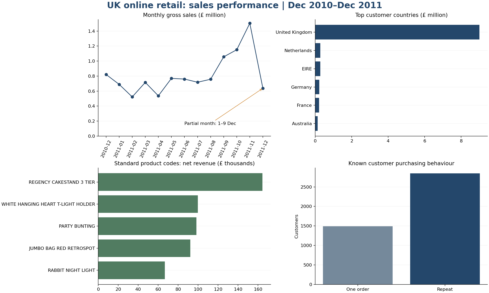

# Sales Performance Analysis

A historical retail portfolio case study covering monthly sales, product revenue, customer-country performance and purchasing behaviour. The objective is to turn messy transaction records into reliable measures and practical business recommendations.

**Tools:** Excel and Power Query, MySQL 8, Power BI Desktop. Python scripts provide a reproducible reference analysis and independent arithmetic checks.



## Business questions

1. How do sales vary by month, and which comparisons are affected by incomplete data?
2. Which invoice items and standard-coded products contribute the most net revenue?
3. Which customer countries contribute the most sales?
4. How often do identified customers purchase more than once?
5. What do credits and missing customer identifiers mean for interpretation?

## Key results

| Measure | Result |
|---|---:|
| Raw transaction lines | 541,909 |
| Clean ledger lines | 534,129 |
| Gross sales | £10,642,110.80 |
| Credit value | £893,979.73 |
| Net revenue | £9,748,131.07 |
| Sale invoices | 19,960 |
| Average order value | £533.17 |
| Known purchasing customers | 4,338 |
| Repeat purchase rate among known customers | 65.6% |

The UK represents 84.6% of gross sales. November 2011 is the strongest complete month. December 2011 covers only 1–9 December. Postage is separated from merchandise interpretation, and unknown customer IDs remain in overall sales figures.

## Files and how to start

| Folder/file | Purpose |
|---|---|
| `docs/START_TO_FINISH.md` | Detailed Windows/VS Code, Excel, MySQL, Power BI and GitHub walkthrough |
| `docs/CV_AND_INTERVIEW.md` | CV wording, role tailoring and interview preparation |
| `docs/DATA_DICTIONARY.md` | Fields, cleaning rules and KPI definitions |
| `data/raw/Online Retail.xlsx` | Unchanged original public dataset |
| `data/processed/sales_clean.csv` | Full cleaned ledger, not a sample |
| `data/processed/metrics.json` | Expected reconciliation results |
| `excel/Sales_Performance_Analysis.xlsx` | Completed full-data summary workbook with formulas, charts and a labelled learning sample |
| `excel/Clean_raw_retail.pq` | Power Query cleaning logic for the original workbook |
| `sql/` | MySQL schema, import, analysis, validation and product-subset queries |
| `powerbi/` | CSV import query, DAX measures, theme and report specification |
| `reports/findings.md` | Findings, five recommendations and limitations |
| `reports/validation.md` | Checks performed and target-engine limitations |
| `scripts/` | Reproducible reference analysis and figure generation |

## Reproduce the reference analysis

With Python 3.10+ installed, from the project root:

```powershell
py -m venv .venv
.venv\Scripts\python.exe -m pip install -r requirements.txt
.venv\Scripts\python.exe scripts\build_analysis.py
.venv\Scripts\python.exe scripts\build_report.py
```

The workbook's aggregate inputs are a delivered snapshot. The scripts rebuild CSV outputs and figures, not the workbook. See the walkthrough for replacing the workbook summary inputs or using Power Query/PivotTables to create your own refreshed view.

## Desktop completion status

The dataset analysis, CSV outputs, Excel workbook and report are supplied. The MySQL scripts and Power BI M/DAX are supplied for desktop execution. **A native Power BI `.pbix` report is not included.** Complete and reconcile the desktop steps before describing the Power BI report as built or the MySQL queries as executed. The included images are Excel/reference-analysis outputs, not Power BI screenshots.

After you complete these steps, replace this status paragraph with an accurate account of your work and add `powerbi/Sales_Performance.pbix` plus report-page screenshots.

## Method and limitations

The source has 541,909 lines. Exact duplicate removal leaves 536,641 lines. Excluding 2,512 invalid lines leaves 534,129 ledger lines. Credits remain in the ledger. Customer metrics exclude missing IDs while revenue metrics keep those transactions. Headline values include shipping/manual invoice items. No cost or profit data is available. Product ranking uses StockCode, and the standard-code subset is explicitly defined rather than treated as a source taxonomy.

Independent SQLite totals reconcile to the reference results. The supplied MySQL, Power Query and DAX require target-application validation. This project does not claim measured business improvements or a real client engagement.

## Source

Chen, D. (2015). Online Retail [Dataset]. UCI Machine Learning Repository. https://doi.org/10.24432/C5BW33. Licensed CC BY 4.0. See [DATA_LICENSE.md](DATA_LICENSE.md) for attribution and changes.
